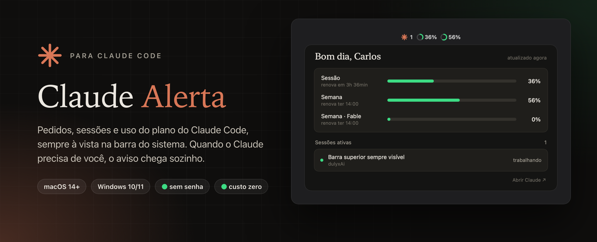
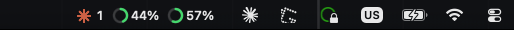
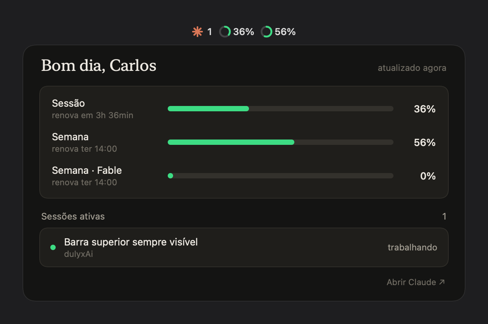
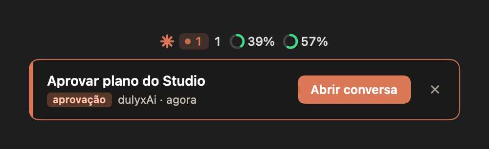
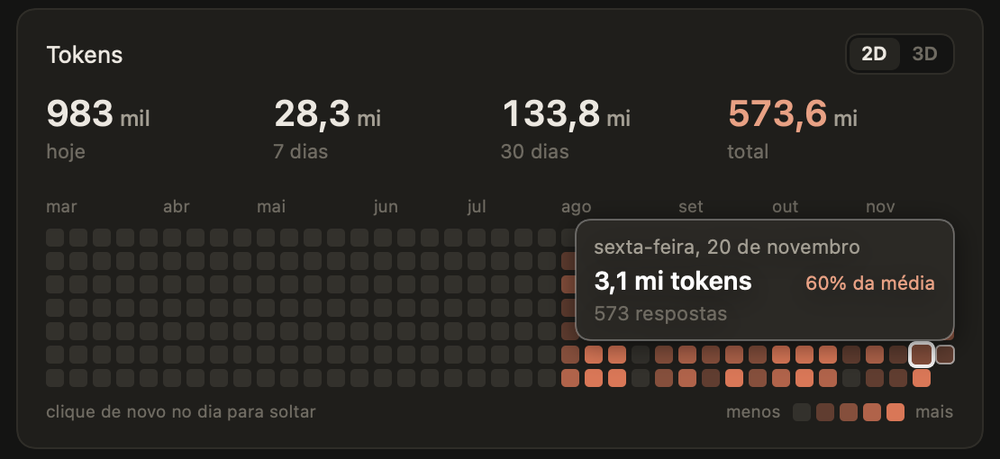
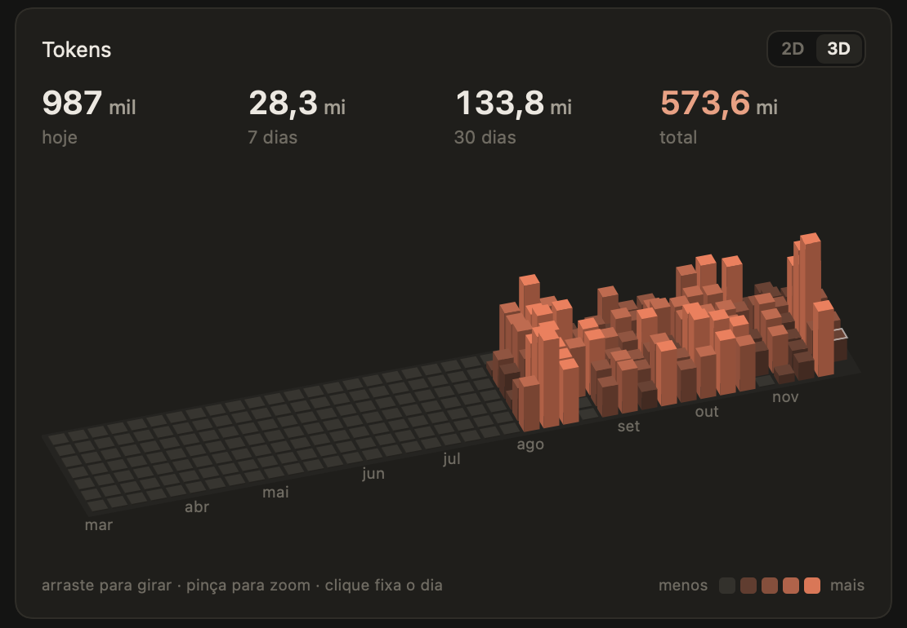
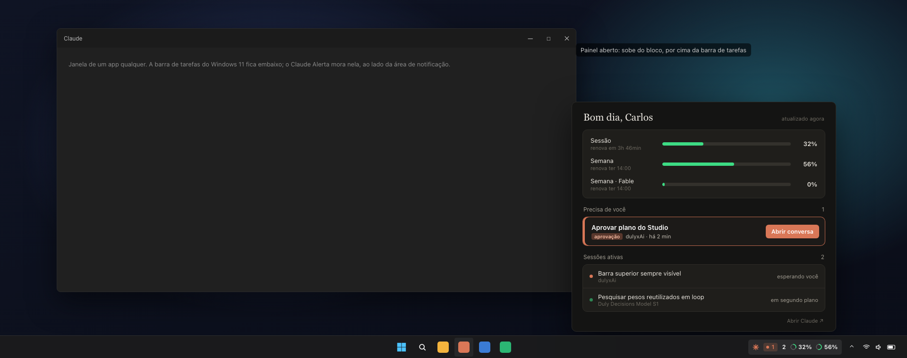
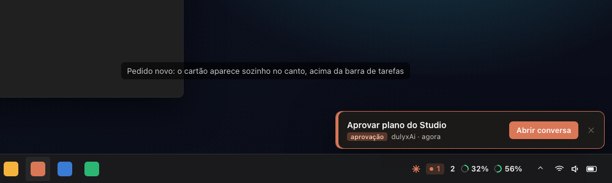
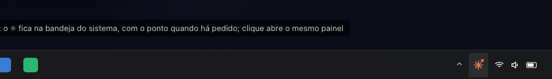
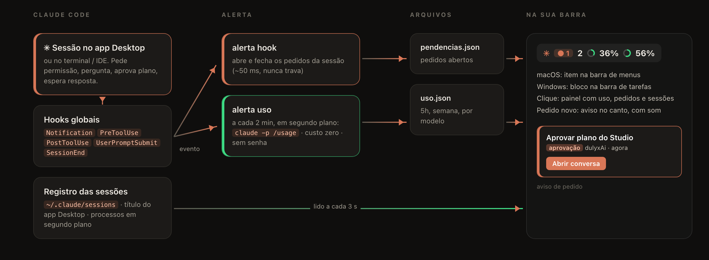

<p align="center">
  
</p>

<p align="center">
  
  
  
  
  
  
</p>

<p align="center">
  <b>Pedidos que esperam você, sessões trabalhando e uso do plano do Claude Code, sempre à vista na barra do sistema.</b><br>
  Quando o Claude precisa de você, o aviso chega sozinho, e um clique leva direto à conversa certa.
</p>

<p align="center">
  <a href="#-como-fica">Como fica</a> ·
  <a href="#-recursos">Recursos</a> ·
  <a href="#-instalar">Instalar</a> ·
  <a href="#%EF%B8%8F-como-funciona">Como funciona</a> ·
  <a href="macos/README.md">Guia macOS</a> ·
  <a href="windows/README.md">Guia Windows</a>
</p>

---

## 👀 Como fica

### macOS: na barra de menus

<p align="center">
  <br>
  <sub>Item nativo no canto superior direito, antes dos outros ícones: <b>✳︎ sessões ativas · ◯ sessão de 5h · ◯ semana</b></sub>
</p>

<table>
  <tr>
    <td width="50%" align="center">
      <br>
      <sub><b>Painel</b>: um clique no item. Uso de 5h, semana e por modelo, pedidos e sessões ativas.</sub>
    </td>
    <td width="50%" align="center">
      <br>
      <sub><b>Aviso de pedido</b>: aparece sozinho no canto superior direito, com som se você estiver em outro app.</sub>
    </td>
  </tr>
</table>

### Uso por dia: grid de tokens em 2D e 3D

<table>
  <tr>
    <td width="50%" align="center">
      <br>
      <sub><b>2D</b>: um quadrado por dia, como o grid do GitHub. Passe o mouse para ver os tokens, as respostas e a comparação com a média; o clique fixa o dia.</sub>
    </td>
    <td width="50%" align="center">
      <br>
      <sub><b>3D</b>: cada dia vira uma barra com altura pelos tokens. Arraste para girar e inclinar; use pinça no trackpad ou roda do mouse para o zoom e ↺ para voltar.</sub>
    </td>
  </tr>
</table>

### Windows: na barra de tarefas

<p align="center">
  <br>
  <sub>Bloco ao lado da área de notificação; o painel sobe dele.</sub>
</p>

<table>
  <tr>
    <td width="55%" align="center">
      <br>
      <sub><b>Aviso de pedido</b>: no canto inferior direito, onde o Windows mostra as notificações.</sub>
    </td>
    <td width="45%" align="center">
      <br>
      <sub><b>Só o ícone</b>: o ✳︎ vai para a bandeja do sistema, com um ponto quando há pedido.</sub>
    </td>
  </tr>
</table>

> [!NOTE]
> Os prints do macOS são do app rodando. Os do Windows são simulações do Windows 11, com o mesmo visual e o mesmo layout do app. O código Windows compila sem erros como C# 5 para o .NET Framework 4.8, que é o mesmo compilador que o instalador usa, mas ainda não rodou numa máquina Windows.

---

## ✨ Recursos

<table>
  <tr>
    <td width="33%" valign="top">
      <h3>🔔 Pedidos</h3>
      Permissão, pergunta, plano para aprovar, chave, decisão. O aviso aparece sozinho, 6 s depois do pedido, para nunca chegar antes da mensagem do Claude, e some quando você clica em <b>Abrir conversa</b> ou responde na própria sessão.
    </td>
    <td width="33%" valign="top">
      <h3>📊 Uso do plano</h3>
      Sessão de 5 horas, semana e limites por modelo (como o Fable), com o horário em que cada um renova. Verde abaixo de 60%, argila até 85%, vermelho acima.
    </td>
    <td width="33%" valign="top">
      <h3>⚡ Sessões ativas</h3>
      As que estão trabalhando, esperando você ou com tarefa em segundo plano, com o título que o app Desktop mostra na barra lateral.
    </td>
  </tr>
  <tr>
    <td valign="top">
      <h3>🎯 Um clique, conversa certa</h3>
      Abre a conversa no app do Claude. Em thread de projeto, abre o projeto com a thread ao lado.
    </td>
    <td valign="top">
      <h3>🔒 Sem senha, custo zero</h3>
      Não lê o Keychain nem guarda token. O uso vem do <code>/usage</code> do próprio Claude Code, que não chama o modelo.
    </td>
    <td valign="top">
      <h3>🎨 Visual do Claude</h3>
      Escuro, argila e serifa. Modo <b>só o ícone</b> para quem quer a barra limpa. Hover e cursor em tudo que é clicável.
    </td>
  </tr>
</table>

---

## 🚀 Instalar

<table>
  <tr>
    <th width="50%">🍎 macOS 14 (Sonoma) ou mais novo</th>
    <th width="50%">🪟 Windows 10 ou 11</th>
  </tr>
  <tr>
    <td valign="top">

Precisa das ferramentas de linha de comando da Apple (`xcode-select --install`, se ainda não tiver).

```bash
bash ~/Desktop/ccorgzdev/claude-alerta/macos/instalar.sh
```

Compila o app, coloca para abrir no login, liga os hooks do Claude Code em `~/.claude/settings.json` (com cópia do original) e faz a primeira leitura do uso.

📖 [Guia completo do macOS](macos/README.md)

  </td>
  <td valign="top">

Não precisa instalar nada antes: usa o compilador C# do .NET Framework 4.8, que já vem no Windows.

1. Baixe o projeto (botão **Code → Download ZIP** no GitHub) e abra a pasta `windows`.
2. Dê dois cliques em **`instalar.cmd`**.

Compila o app e o `alerta.exe`, coloca para abrir no login, liga os hooks em `%USERPROFILE%\.claude\settings.json` (com cópia do original) e abre o app. Sem administrador.

📖 [Guia completo do Windows](windows/README.md)

  </td>
  </tr>
</table>

> [!TIP]
> Para as sessões também abrirem pedidos manuais (chave, decisão, aprovação), cole a regra do `PROMPT-AGENTE.md` da sua versão no seu `CLAUDE.md` global. O mesmo arquivo traz um prompt para o próprio Claude Code fazer a instalação.

### 🧪 Testar

<table>
  <tr><th>macOS</th><th>Windows (PowerShell)</th></tr>
  <tr>
    <td>

```bash
~/.claude-alerta/bin/alerta abrir "Teste" \
  --detalhe "Olá" --tipo decisao
```

  </td>
  <td>

```powershell
& "$env:USERPROFILE\.claude-alerta\bin\alerta.exe" `
  abrir "Teste" --detalhe "Olá" --tipo decisao
```

  </td>
  </tr>
</table>

O aviso aparece sozinho. Feche com `alerta fechar <id>`, usando o id que o comando imprimiu.

---

## ⚙️ Como funciona

<p align="center">
  
</p>

- **Pedidos**: os hooks do Claude Code abrem um pedido quando a sessão pede permissão, faz uma pergunta, quer aprovar um plano ou fica esperando resposta, e fecham quando você responde.
- **Uso**: `claude -p /usage` não chama o modelo (custo zero). Ele roda de dentro das sessões, porque é ali que o app Desktop entrega o login. Por isso nunca pede senha.
- **Sessões**: o app lê o registro que o próprio Claude Code mantém, o título do app Desktop e os comandos rodando em segundo plano.

| | 🍎 macOS | 🪟 Windows |
|---|---|---|
| **Onde fica** | barra de menus, antes dos outros ícones | barra de tarefas, ao lado da área de notificação |
| **Painel** | desce do item | sobe do bloco |
| **Aviso de pedido** | canto superior direito | canto inferior direito, acima da barra de tarefas |
| **Só o ícone** | ✳︎ na barra de menus | ✳︎ na bandeja do sistema |
| **Feito com** | Swift / SwiftUI | C# / WPF (.NET Framework 4.8) |
| **Compilado** | na instalação, com `swiftc` | na instalação, com o `csc.exe` do próprio Windows |
| **Abre no login** | LaunchAgent | chave `Run` do usuário |

---

## 📁 Estrutura

```
claude-alerta/
├── README.md       este arquivo
├── LICENSE         MIT
├── docs/           banner e diagrama deste README
├── macos/          versão macOS: instalador, comando, app, prints, guia
└── windows/        versão Windows: instalador, comando, app, simulações, guia
```

## 🧹 Desinstalar

| macOS | Windows |
|---|---|
| `bash ~/Desktop/ccorgzdev/claude-alerta/macos/desinstalar.sh` | dois cliques em `windows\desinstalar.cmd` |

Os dois fecham o app, tiram do login, removem os hooks do `settings.json` e apagam a pasta `.claude-alerta`.

---

<p align="center">
  <sub>Licença MIT · feito para quem passa o dia com o Claude Code aberto</sub>
</p>
