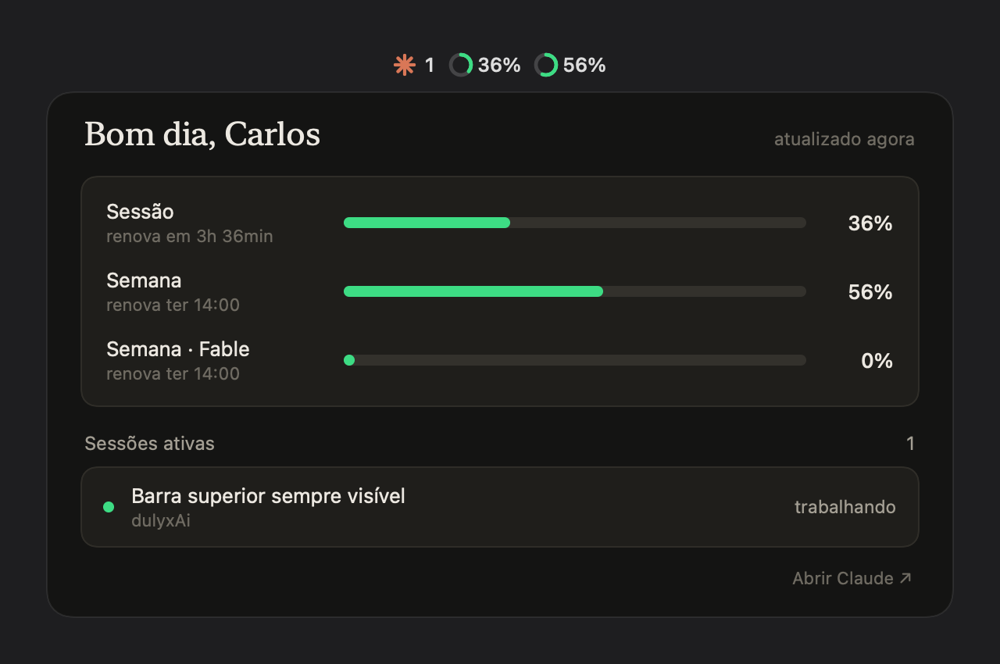
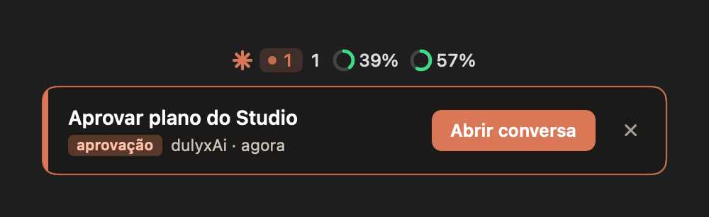

# Claude Alerta — macOS

Um item fixo na barra de menus do Mac, no canto superior direito, logo antes dos outros ícones (Wi-Fi, bateria, relógio). Ele mostra, sempre à vista:

- **pedidos do Claude Code**: quando uma sessão precisa de você (permissão, resposta, chave, decisão, aprovação);
- **sessões ativas**: as sessões do Claude Code que estão trabalhando agora ou esperando você;
- **uso do plano**: quanto da sessão de 5 horas e da semana você já gastou, e quando renovam.

Clicando no bloco, o painel completo desce dele:



Quando chega um pedido e você está em outro app, o cartão desce sozinho:



Funciona com o **app Claude Desktop** (aba Code) e com o Claude Code no terminal. Não pede senha, não lê o Keychain e não guarda token nenhum.

## O que ele faz

- **Item nativo da barra de menus** (`NSStatusItem`): o macOS coloca o item logo antes dos outros ícones do canto direito, abre espaço para ele (nunca fica por cima de menu de app nem de outro ícone), usa as cores da barra (clara ou escura) e mostra o item em todos os monitores. Dá para mudar a posição arrastando com ⌘ pressionado, e o macOS lembra dela. Num MacBook com muitos ícones, o macOS esconde atrás do notch os que não cabem, como faz com qualquer item.
- **Fechado**, ocupa só a largura do conteúdo: `✳ 2 ◯ 28% ◯ 55%`, que são as sessões ativas, o anel da sessão de 5h e o anel da semana. Com pedido aberto, aparece `● 1` em argila ao lado do ✳. Passe o mouse em cada parte para ver o que é e quando renova.
- **Só o ícone:** botão direito no bloco, depois *Mostrar só o ícone*. Fica só o ✳, como o ícone nativo do Claude, com um ponto argila quando há pedido. A escolha fica salva em `~/.claude-alerta/config.json` (`{"barra": "icone"}` ou `{"barra": "completa"}`).
- **Aviso de pedido**: todo pedido novo aparece sozinho no canto superior direito da tela, logo abaixo da barra, num cartão com borda e faixa argila (até 3 cartões; o resto vira "+ N pedidos"). Se você está em outro app, o aviso fica até o pedido ser resolvido ou você clicar em **✕**, que esconde só aquele cartão (ele continua no painel). No painel aberto, o **✕** de cada pedido o fecha sem abrir a conversa, e **Fechar todos** fecha todos de uma vez. Se o Claude está na frente, ele sobe sozinho depois de 8 segundos. Todo pedido espera **6 segundos** antes de aparecer (aviso, som e contador), para não chegar antes da mensagem do Claude na conversa; resolvido nesse meio-tempo, nem aparece. O tempo é ajustável em `~/.claude-alerta/config.json` (`{"atraso": 6}`, em segundos).
- **Aberta (clique)**, mostra:
  - **Uso**: sessão (5h), semana e os limites semanais por modelo (por exemplo, "Semana · Fable"), com barra, porcentagem e "renova em…". Os limites por modelo aparecem só no painel aberto. A cor fica verde abaixo de 60%, argila até 85% e vermelha acima disso.
  - **Precisa de você**: cada pedido com tipo, projeto e há quanto tempo espera. **Abrir conversa** leva direto à conversa no app do Claude e já dá o pedido por resolvido: ele some na hora.
  - **Sessões ativas**: as que estão trabalhando, esperando você ou com tarefa em segundo plano (comando ou monitor rodando depois do fim do turno), com nome, pasta e estado. Sessão parada sai da lista, mesmo com o processo ainda aberto. Clicar numa sessão abre a conversa dela. O nome é o título que o app Desktop mostra na barra lateral. Threads de projeto aparecem com o tópico da thread e o nome do projeto embaixo, e o clique abre o projeto com a thread ao lado (`claude://claude.ai/code/project/chan_…?thread=cmsg_…`). O projeto e a thread vêm da mensagem de abertura da própria conversa (`~/.claude/projects/*/<sessão>.jsonl`).
- **O painel desce de cima para baixo, logo abaixo do item**, e sobe de volta para ele ao fechar. O aviso sai do canto superior direito.
- **Hover e cursor de mão** em tudo que é clicável, mesmo com o app inativo (ele nunca fica na frente).
- **Tudo que é clicável reage ao mouse** (fundo claro só em volta do conteúdo, e cursor de mão). Um clique só basta, mesmo com outro app em foco. **Clicar fora** fecha o painel. **Botão direito** na ilha: abrir o arquivo de pedidos, atualizar o uso agora, sair.
- **Chama atenção sem irritar.** Na chegada de um pedido, quando o Claude não está na frente, toca um som e o ponto pulsa. Se o pedido continuar aberto, repete a cada 3 minutos.
- **Automático**: hooks globais do Claude Code abrem os pedidos (permissão, pergunta, plano para aprovar, espera por resposta) e fecham quando você responde ou aprova.

## Requisitos

- **macOS 14 (Sonoma) ou mais novo.**
- **Ferramentas de linha de comando da Apple**: o instalador usa `swiftc` e `/usr/bin/python3`. Se não tiver, rode `xcode-select --install`.
- **Claude Code no próprio Mac**: pelo app Claude Desktop (aba Code), pelo terminal ou por IDE.
- **App Claude com Acessibilidade ligada** (para threads de projeto na nuvem): é a mesma chave que o Claude já usa para controlar o computador. O Claude Alerta não pede nenhuma permissão própria. Veja [Threads na nuvem](#threads-na-nuvem).
- **Para o uso de 5h/semana**: conta do Claude com plano (Pro, Max, Team ou Enterprise). Com chave de API, Bedrock ou Vertex não existe limite de plano, e essa parte fica vazia.

Não precisa instalar mais nada: sem Homebrew, sem Node, sem pacote Python.

## Instalar

```bash
bash ~/Desktop/ccorgzdev/claude-alerta/macos/instalar.sh
```

O instalador:

1. copia o comando para `~/.claude-alerta/bin/alerta`;
2. compila o app em `~/.claude-alerta/app/ClaudeAlerta`;
3. registra o app para abrir no login (`~/Library/LaunchAgents/com.claude-alerta.plist`). Isso só acontece na primeira vez, para o macOS não repetir o aviso de "Background Activity";
4. liga os hooks no `~/.claude/settings.json` sem mexer no resto do arquivo. Na primeira instalação, guarda uma cópia em `settings.json.antes-claude-alerta`;
5. compila o leitor da janela do Claude (`bin/alerta-tela`), que os hooks ligam sozinhos;
6. tenta ler o uso pela primeira vez. Se não conseguir, a barra preenche sozinha na primeira vez que uma sessão do Claude Code rodar.

Para atualizar, basta rodar de novo: ele recompila e reinicia o app. O binário novo é compilado à parte, assinado de novo (`codesign --force --sign -`) e só depois trocado, porque sobrescrever o binário em uso faz o macOS matar o app.

Depois de instalar, para as sessões também abrirem pedidos manuais (chave, decisão…), cole a regra de [PROMPT-AGENTE.md](PROMPT-AGENTE.md) no seu `~/.claude/CLAUDE.md`. Também dá para pedir ao próprio Claude Code com o prompt de instalação que está no mesmo arquivo.

## Testar

```bash
~/.claude-alerta/bin/alerta abrir "Teste" --detalhe "Olá" --tipo decisao
```

A pílula "1 pede você" aparece na ilha. Feche o teste com o id que o comando imprimiu:

```bash
~/.claude-alerta/bin/alerta fechar <id>
```

Para conferir o uso na hora:

```bash
~/.claude-alerta/bin/alerta uso
```

Fora de uma sessão do Claude Code, esse comando só funciona se o `claude` estiver no PATH. Rodando dentro de uma sessão (inclusive do app Desktop), funciona sempre.

## De onde vem cada informação

| Na ilha | Fonte | Atualiza |
|---|---|---|
| Pedidos | `~/.claude-alerta/pendencias.json`, escrito pelo comando `alerta` (hooks e sessões) | a cada 1 s |
| Pedidos de threads na nuvem | `~/.claude-alerta/tela.json`, escrito por `alerta-tela` (cartões "Allow Claude…" na janela do Claude) | a cada 3 s |
| Sessões ativas | `~/.claude/sessions/*.json`, que o próprio Claude Code mantém (só conta processo vivo); título em `~/Library/Application Support/Claude/claude-code-sessions/` | a cada 3 s |
| Uso 5h / semana | `~/.claude-alerta/uso.json`, escrito por `alerta uso` | o app relê a cada 5 s; os hooks renovam o arquivo no máximo a cada 2 min e, se nenhuma sessão local rodar, o próprio app pede leitura nova quando ela passa de 3 min |
| Uso por dia (grid) | `~/.claude-alerta/atividade.json`, escrito por `alerta atividade` a partir do histórico local `~/.claude/projects` | o app pede a cada 5 min; só lê o que cresceu desde a última vez. Conta tokens de entrada, saída e cache criado (leitura de cache não entra), só das sessões locais. Passando o mouse num dia aparece a data, os tokens, as respostas e a comparação com a média; clicar fixa o dia |

### Como o uso é lido (e por que não pede senha)

O próprio Claude Code tem o comando `/usage`. Rodado como `claude -p /usage --no-session-persistence`, ele **não chama o modelo** (custo zero, nenhum token) e devolve a sessão de 5h e a semana em cerca de 2 segundos.

O detalhe importante é que, no app Desktop, a autenticação vive dentro do app e é entregue às sessões que ele abre. Por isso a leitura é disparada **de dentro das sessões**, pelo hook:

```
sessão do Claude Code (Desktop ou terminal)
   └─ hook PostToolUse / UserPromptSubmit / Notification ...
        └─ alerta hook ── (no máximo a cada 2 min, em segundo plano) ──> alerta uso
                                                                           └─ claude -p /usage
                                                                                └─> ~/.claude-alerta/uso.json ──> ilha
```

- O hook volta em ~50 ms. A leitura roda solta e nunca atrasa a sessão.
- O hook acha o executável do Claude Code pelo processo da própria sessão (`CLAUDE_PID`). Se não achar, procura o `claude` no PATH e, por último, o Claude Code que vem dentro do app Desktop.
- Quando uma janela renova (por exemplo, passou o horário da sessão de 5h) e ninguém usou o Claude depois disso, a ilha mostra 0%, que é o valor real.
- **Nada de Keychain.** Ler o login direto do Keychain faz o macOS pedir a senha do usuário. Por isso esse caminho não é usado.

## Comando `alerta`

| Comando | O que faz |
|---|---|
| `alerta abrir "título" [--detalhe "..."] [--tipo chave\|decisao\|aprovacao\|outro] [--sessao nome] [--link url]` | Abre um pedido e imprime o id. Rodado de dentro de uma sessão, guarda qual é ela: quando você responder lá, o pedido fecha sozinho |
| `alerta fechar <id>` | Fecha um pedido |
| `alerta limpar-sessao <nome>` | Fecha todos os pedidos de uma sessão |
| `alerta listar` | Lista os pedidos abertos |
| `alerta uso` | Lê o uso do plano e grava em `~/.claude-alerta/uso.json` |
| `alerta atividade` | Soma os tokens de cada dia no histórico local e grava em `atividade.json` (grid do painel) |
| `alerta hook` | Usado pelos hooks: lê o evento do Claude Code na entrada padrão |

Os pedidos abertos dentro de uma sessão da aba Code do app ganham sozinhos o link `claude://code/continue?session=local_…`, que leva direto àquela conversa. Em thread de projeto, o link abre o projeto com a thread ao lado.

## Hooks instalados

| Evento do Claude Code | Efeito |
|---|---|
| `Notification` (pede permissão ou espera resposta) | abre um pedido automático da sessão (um por sessão) |
| `PreToolUse` de `AskUserQuestion` ou `ExitPlanMode` | abre o pedido na hora |
| `UserPromptSubmit` (você respondeu na sessão) | fecha **todos** os pedidos da sessão, inclusive os abertos à mão com `alerta abrir` |
| `PostToolUse` de `AskUserQuestion` ou `ExitPlanMode` (você respondeu a pergunta ou o plano) | fecha **todos** os pedidos da sessão |
| `PostToolUse` das outras ferramentas (você aprovou e ela rodou) | fecha só o pedido automático da sessão |
| `Stop` (terminou de responder) | abre o aviso "Terminou: <conversa>", com o começo da resposta e o link. Ele some sozinho 10 s depois de aparecer |
| `SessionEnd` | fecha todos os pedidos da sessão |
| todos acima | disparam a leitura do uso (no máximo a cada 2 min) e ligam o leitor da janela, se estiver parado |

Os hooks nunca bloqueiam a sessão: qualquer erro é engolido.

### Threads na nuvem

Threads e coordenador de projetos do claude.ai rodam **na nuvem**. Quando pedem algo ("Allow Claude to connect to …", uma pergunta, uma aprovação), nada passa pelo Mac: não há hook, arquivo nem log local. E a thread não consegue avisar por conta própria justamente quando perdeu a conexão com o Mac.

Por isso o `bin/alerta-tela` lê a janela do app Claude a cada 3 s e grava em `~/.claude-alerta/tela.json` todo cartão com "Allow Claude…" seguido de um botão "Deny". Para os projetos que **não estão abertos** na janela, o leitor usa os **banners** que o próprio app Claude manda pelo macOS quando uma thread pede algo ou termina com o app em segundo plano. Ele confere a Central de Notificações a cada 1 s, e cada banner do Claude vira um pedido com o nome da thread, o projeto e o link do projeto. O leitor aprende sozinho o link de cada projeto quando você abre o projeto no app, e guarda isso em `~/.claude-alerta/projetos.json`. Quando você abre a thread no Claude, o pedido fecha sozinho. Banner de algo que os hooks já avisaram não repete. Para isso, as notificações do Claude precisam estar em **Banners** (o padrão) e o modo Foco não pode estar bloqueando o Claude. Tudo o que o leitor vê fica anotado em `~/.claude-alerta/tela.log`.

Para saber quando uma conversa ou thread **terminou de responder**, o app usa o hook `Stop` do Claude Code. As threads de projeto conectadas ao Mac rodam como sessões locais, então ele vale para elas também. O aviso traz o nome da conversa (ou o tópico da thread e o projeto), o começo da resposta e o link que abre a conversa certa. O aviso "N threads waiting on you" da janela não é usado, porque não diz qual thread é.

O app transforma isso em pedido, que some sozinho quando sai da tela. Se você clicar em "Abrir conversa" e o mesmo cartão voltar depois, ele avisa de novo.

**Sem permissão nova.** O leitor é ligado pelo hook de dentro de uma sessão do Claude Code, então o macOS o atribui ao próprio app Claude. Basta o **Claude** estar ligado em Ajustes do Sistema → Privacidade e Segurança → Acessibilidade, o que já acontece quando você usa o controle do computador. Se não estiver, o leitor grava `"permissao": false` e sai, sem abrir janela nenhuma.

- Ele começa na primeira vez que alguma sessão do Claude Code roda depois de ligar o Mac, e fica uma instância só.
- Só vê o que está desenhado na janela do Claude, mesmo com ela atrás de outras janelas. O pedido de um projeto que não está aberto no app não aparece.
- Para conferir o que ele lê: `~/.claude-alerta/bin/alerta-tela --uma`.

As threads conectadas ao Mac também podem acender pedidos com `bin/nuvem` (instruções no próprio arquivo).

## Estrutura

```
claude-alerta/macos/
├── README.md                este arquivo
├── PROMPT-AGENTE.md         prompt de instalação, regra para as sessões e resumo técnico
├── instalar.sh              instala ou atualiza
├── desinstalar.sh           remove tudo (app, login, hooks, pedidos e uso salvo)
├── bin/alerta               comando (Python 3, sem dependências)
├── bin/nuvem                pedidos gravados por threads na nuvem conectadas ao Mac
├── src/AlertaTela.swift     leitor da janela do Claude (vira bin/alerta-tela)
├── src/ClaudeAlerta.swift   app (Swift/SwiftUI, arquivo único, sem dependências)
└── docs/                    prints do app (barra, painel, aviso)
```

Arquivos criados na máquina:

```
~/.claude-alerta/bin/alerta            comando instalado
~/.claude-alerta/app/ClaudeAlerta      app compilado (+ erro.log)
~/.claude-alerta/pendencias.json       pedidos abertos
~/.claude-alerta/uso.json              último uso lido
~/.claude-alerta/config.json           preferências (barra completa ou só o ícone)
~/Library/LaunchAgents/com.claude-alerta.plist
~/.claude/settings.json                hooks (o resto do arquivo não é tocado)
```

## Desinstalar

```bash
bash ~/Desktop/ccorgzdev/claude-alerta/macos/desinstalar.sh
```

Esse script fecha o app, tira ele do login, remove os hooks do `~/.claude/settings.json` e apaga a pasta `~/.claude-alerta`. A regra no `~/.claude/CLAUDE.md`, se você colou, precisa ser tirada à mão.

## Problemas comuns

- **A ilha não aparece:** veja se o app está rodando com `pgrep -l ClaudeAlerta`. Para reiniciar, rode `launchctl kickstart -k gui/$(id -u)/com.claude-alerta`. Se `launchctl print gui/$(id -u)/com.claude-alerta` mostrar `OS_REASON_CODESIGNING`, o binário foi sobrescrito em uso: rode o `instalar.sh` de novo.
- **O uso mostra "–" ou "O uso aparece quando uma sessão do Claude Code rodar":** ainda não houve leitura. Use qualquer sessão do Claude Code por um instante, ou rode `alerta uso` de dentro de uma sessão. Com chave de API (sem plano), não existe uso de plano para mostrar.
- **O uso parece velho:** o painel mostra "atualizado há X". Ele só renova enquanto alguma sessão está em uso, e no máximo a cada 2 min. Para forçar, use o botão direito na ilha e *Atualizar uso agora*, depois rode `alerta uso` numa sessão.
- **"Abrir conversa" abre só o app:** o pedido não tem link. Em threads de projeto, passe `--link https://claude.ai/code/project/<projeto>?thread=<thread>`.
- **Threads na nuvem não geram alerta:** rode `~/.claude-alerta/bin/alerta-tela --uma`. Se mostrar `"permissao": false`, ligue o **Claude** em Acessibilidade. O leitor sobe com a próxima ação de qualquer sessão do Claude Code.
- **Conferir o visual sem olhar a tela:** `ALERTA_PNG=/tmp/ilha.png ~/.claude-alerta/app/ClaudeAlerta` grava um PNG do painel aberto e sai. Com `ALERTA_PNG_AVISO=1`, grava o aviso de pedido; com `ALERTA_PNG_AVISO=1 ALERTA_PNG_ICONE=1`, o modo só ícone.
- **Erros do app:** veja `~/.claude-alerta/app/erro.log`.
