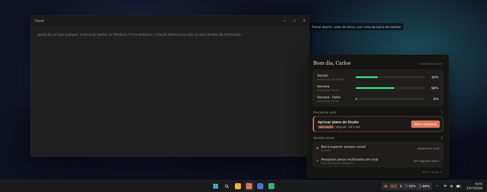
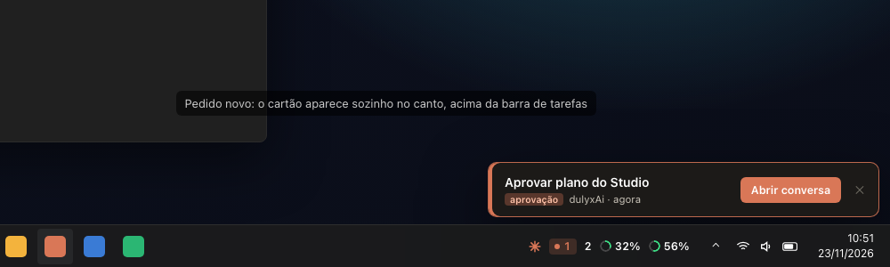
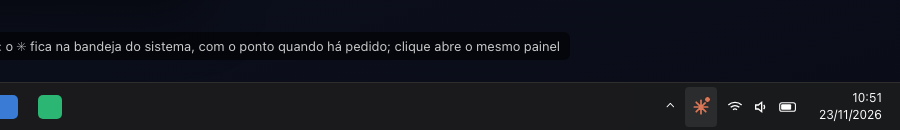

# Claude Alerta — Windows

Um bloco fixo na **barra de tarefas do Windows 10/11**, logo à esquerda da área de notificação (relógio, Wi-Fi, som). Ele mostra, sempre à vista:

- **pedidos do Claude Code**: quando uma sessão precisa de você (permissão, resposta, chave, decisão, aprovação);
- **sessões ativas**: as sessões do Claude Code que estão trabalhando, esperando você ou com tarefa em segundo plano;
- **uso do plano**: quanto da sessão de 5 horas e da semana você já gastou, e quando renovam.

Clicando no bloco, o painel completo sobe dele:



Quando chega um pedido, o cartão aparece sozinho no canto:



No modo só ícone, o ✳ fica na bandeja do sistema:



As imagens são simulações do Windows 11 (`docs/simulacao.html`). O código compila sem erros como C# 5 para o .NET Framework 4.8, que é exatamente o que o instalador usa, mas ainda não rodou numa máquina Windows. O visual, os arquivos e o comportamento são os mesmos da versão macOS.

Funciona com o **app Claude Desktop** (aba Code) e com o Claude Code no terminal. Não pede senha e não guarda token nenhum.

## O que ele faz

- **Bloco na barra de tarefas.** Transparente sobre a barra, com as cores do tema dela (clara ou escura). Fechado, mostra `✳ ●1 2 ◯32% ◯56%`: pedidos (só quando há), sessões ativas, e os anéis da sessão de 5h e da semana. Passe o mouse em cada parte para ver o que é e quando renova. Some sozinho quando um app está em tela cheia.
- **Painel (clique no bloco):** sobe do bloco e traz:
  - **Uso**: sessão (5h), semana e os limites semanais por modelo (por exemplo, "Semana · Fable"), com barra, porcentagem e "renova em…". A cor fica verde abaixo de 60%, argila até 85% e vermelha acima disso.
  - **Precisa de você**: cada pedido com tipo, projeto e há quanto tempo espera. **Abrir conversa** leva direto à conversa no app do Claude.
  - **Sessões ativas**: nome, pasta e estado (trabalhando, esperando você, em segundo plano). Clicar numa sessão abre a conversa dela. Threads de projeto aparecem com o tópico e o nome do projeto, e abrem o projeto com a thread ao lado.
- **Clicar fora** fecha o painel. **Botão direito** no bloco ou no ícone: *Mostrar só o ícone*, abrir o arquivo de pedidos, atualizar o uso agora, sair.
- **Aviso de pedido**: todo pedido novo aparece sozinho no canto inferior direito, acima da barra de tarefas (onde o Windows mostra as notificações), num cartão com borda e faixa argila. Se você está em outro app, toca um som e o aviso fica até o pedido ser resolvido ou você clicar em **✕**. Se o Claude está na frente, ele recolhe sozinho depois de 8 segundos. Com o pedido ainda aberto, o som se repete a cada 3 minutos.
- **Só o ícone**: o bloco sai da barra e o ✳ vai para a bandeja do sistema, com um ponto argila quando há pedido. O clique abre o mesmo painel, e passar o mouse mostra o uso. A escolha fica salva em `%USERPROFILE%\.claude-alerta\config.json` (`{"barra": "icone"}` ou `{"barra": "completa"}`). Com a barra de tarefas na vertical, o app usa sempre o ícone da bandeja.
- **Automático**: hooks globais do Claude Code abrem os pedidos (permissão, pergunta, plano para aprovar, espera por resposta) e fecham quando você responde ou aprova.

## Requisitos

- **Windows 10 ou 11.**
- **.NET Framework 4.8**, que já vem no Windows 10 (1903+) e no 11. O instalador usa o compilador C# que vem com ele (`csc.exe`), então não precisa instalar Visual Studio, .NET SDK, Python nem nada.
- **Claude Code no próprio PC**: pelo app Claude Desktop (aba Code), pelo terminal ou por IDE. Sessões na nuvem não alcançam os arquivos locais.
- **Para o uso de 5h/semana**: conta do Claude com plano (Pro, Max, Team ou Enterprise). Com chave de API, Bedrock ou Vertex não existe limite de plano, e essa parte fica vazia.

## Instalar

Dê dois cliques em **`instalar.cmd`**. Ou, num PowerShell:

```powershell
powershell -NoProfile -ExecutionPolicy Bypass -File .\instalar.ps1
```

O instalador não precisa de administrador. Ele:

1. compila o comando em `%USERPROFILE%\.claude-alerta\bin\alerta.exe` e o app em `%USERPROFILE%\.claude-alerta\app\ClaudeAlerta.exe`, a partir de `src\`;
2. liga os hooks em `%USERPROFILE%\.claude\settings.json` sem mexer no resto do arquivo. Na primeira vez, guarda uma cópia em `settings.json.antes-claude-alerta`;
3. registra o app para abrir no login (chave `HKCU\Software\Microsoft\Windows\CurrentVersion\Run\ClaudeAlerta`) e já abre o app;
4. tenta ler o uso pela primeira vez. Se não conseguir, o bloco preenche sozinho na primeira vez que uma sessão do Claude Code rodar.

Para atualizar, basta rodar de novo: ele recompila, fecha o app antigo e abre o novo.

Como o app é compilado no seu PC, ele não é um arquivo baixado da internet, e o Windows não mostra o aviso do SmartScreen.

Depois de instalar, para as sessões também abrirem pedidos manuais (chave, decisão…), cole a regra de [PROMPT-AGENTE.md](PROMPT-AGENTE.md) no seu `%USERPROFILE%\.claude\CLAUDE.md`.

## Testar

```powershell
& "$env:USERPROFILE\.claude-alerta\bin\alerta.exe" abrir "Teste" --detalhe "Olá" --tipo decisao
```

O cartão sobe do bloco e o bloco mostra `●1`. Feche o teste com o id que o comando imprimiu:

```powershell
& "$env:USERPROFILE\.claude-alerta\bin\alerta.exe" fechar <id>
```

Para conferir o uso na hora:

```powershell
& "$env:USERPROFILE\.claude-alerta\bin\alerta.exe" uso
```

## De onde vem cada informação

| No bloco | Fonte | Atualiza |
|---|---|---|
| Pedidos | `%USERPROFILE%\.claude-alerta\pendencias.json`, escrito pelo `alerta.exe` (hooks e sessões) | a cada 1 s |
| Sessões ativas | `%USERPROFILE%\.claude\sessions\*.json` (só processo vivo); título em `%APPDATA%\Claude\claude-code-sessions\`; segundo plano pelos processos do Bash do Claude (`shell-snapshots`), via WMI | a cada 3 s |
| Uso 5h / semana | `%USERPROFILE%\.claude-alerta\uso.json`, escrito por `alerta.exe uso` | o app relê a cada 5 s; o arquivo é renovado no máximo a cada 2 min, enquanto houver sessão em uso |

### Como o uso é lido (sem senha)

O próprio Claude Code tem o comando `/usage`. Rodado como `claude.exe -p /usage --no-session-persistence`, ele **não chama o modelo** (custo zero) e devolve a sessão de 5h, a semana e os limites por modelo. No app Desktop, a autenticação é entregue às sessões que ele abre. Por isso a leitura é disparada **de dentro das sessões**, pelo hook, no máximo a cada 2 minutos e em segundo plano, sem atrasar a sessão.

O `alerta.exe` acha o `claude.exe` pelo processo da própria sessão (`CLAUDE_PID`). Se não achar, procura no `PATH` e, por último, em `%APPDATA%\Claude\claude-code\`.

## Comando `alerta.exe`

| Comando | O que faz |
|---|---|
| `alerta abrir "título" [--detalhe "..."] [--tipo chave\|decisao\|aprovacao\|outro] [--sessao nome] [--link url]` | Abre um pedido e imprime o id |
| `alerta fechar <id>` | Fecha um pedido |
| `alerta limpar-sessao <nome>` | Fecha todos os pedidos de uma sessão |
| `alerta listar` | Lista os pedidos abertos |
| `alerta uso` | Lê o uso do plano e grava em `uso.json` |
| `alerta hook` | Usado pelos hooks: lê o evento do Claude Code na entrada padrão |
| `alerta hooks ligar` / `alerta hooks desligar` | Liga ou tira os hooks do `settings.json` |

Os pedidos abertos dentro de uma sessão da aba Code ganham sozinhos o link da conversa (`claude://code/continue?session=local_…`). Em thread de projeto, o link abre o projeto com a thread ao lado (`claude://claude.ai/code/project/chan_…?thread=cmsg_…`).

## Hooks instalados

| Evento do Claude Code | Efeito |
|---|---|
| `Notification` (pede permissão ou espera resposta) | abre um pedido automático da sessão (um por sessão) |
| `PreToolUse` de `AskUserQuestion` ou `ExitPlanMode` | abre o pedido na hora |
| `UserPromptSubmit` (você respondeu) | fecha o pedido automático da sessão |
| `PostToolUse` (você aprovou e a ferramenta rodou) | fecha o pedido automático da sessão |
| `SessionEnd` | fecha todos os pedidos da sessão |
| todos acima | disparam a leitura do uso, no máximo a cada 2 min |

O comando dos hooks é `"C:/Users/<você>/.claude-alerta/bin/alerta.exe" hook`, com barras normais, para funcionar tanto no Git Bash (que o Claude Code usa no Windows) quanto no `cmd`. Os hooks nunca bloqueiam a sessão: qualquer erro é engolido.

## Estrutura

```
claude-alerta/windows/
├── README.md               este arquivo
├── PROMPT-AGENTE.md        prompt de instalação, regra para as sessões e resumo técnico
├── instalar.cmd / .ps1     instala ou atualiza (dois cliques no .cmd)
├── desinstalar.cmd / .ps1  remove tudo
├── src/alerta.cs           comando (C# 5, .NET Framework 4)
├── src/ClaudeAlerta.cs     app (C# 5, WPF + Windows Forms, arquivo único)
├── docs/                   simulações do Windows 11 (painel, aviso, só ícone) e o HTML delas
└── dist/claude-alerta-windows.zip   pacote para mandar para outra pessoa
```

Arquivos criados no PC:

```
%USERPROFILE%\.claude-alerta\bin\alerta.exe        comando
%USERPROFILE%\.claude-alerta\app\ClaudeAlerta.exe  app (+ erro.log)
%USERPROFILE%\.claude-alerta\pendencias.json       pedidos abertos
%USERPROFILE%\.claude-alerta\uso.json              último uso lido
%USERPROFILE%\.claude-alerta\config.json           preferências (barra completa ou só o ícone)
HKCU\...\CurrentVersion\Run\ClaudeAlerta           abre no login
%USERPROFILE%\.claude\settings.json                hooks (o resto do arquivo não é tocado)
```

## Desinstalar

Dê dois cliques em **`desinstalar.cmd`**. Ele fecha o app, tira ele do login, remove os hooks do `settings.json` e apaga a pasta `%USERPROFILE%\.claude-alerta`. A regra no `CLAUDE.md`, se você colou, precisa ser tirada à mão.

## Problemas comuns

- **O bloco não aparece:** veja se o app está rodando no Gerenciador de Tarefas (`ClaudeAlerta.exe`). Se não estiver, abra `%USERPROFILE%\.claude-alerta\app\ClaudeAlerta.exe`. Ele também some de propósito quando um app está em tela cheia, e quando a barra de tarefas está na vertical (aí o ✳ fica na bandeja).
- **O bloco ficou por cima de ícones da barra:** a barra de tarefas do Windows 11 mudou de estrutura algumas vezes, e às vezes o app não acha o começo da área de notificação. Nesse caso ele usa uma estimativa. Use *Mostrar só o ícone* no botão direito.
- **O instalador diz que falhou ao compilar:** rode `instalar.ps1` num PowerShell para ver a mensagem do `csc.exe` e me mande.
- **O uso mostra "–":** ainda não houve leitura. Use qualquer sessão do Claude Code por um instante. Com chave de API (sem plano), não existe uso de plano para mostrar.
- **"Abrir conversa" não abre a conversa:** confira se o app Claude Desktop está instalado (ele registra o link `claude://`).
- **Conferir o visual sem olhar a tela:** com `ALERTA_PNG=C:\caminho\painel.png`, o app grava um PNG do painel aberto e sai. Com `ALERTA_PNG_AVISO=1` junto, grava o aviso de pedido.
- **Erros do app:** veja `%USERPROFILE%\.claude-alerta\app\erro.log`.
